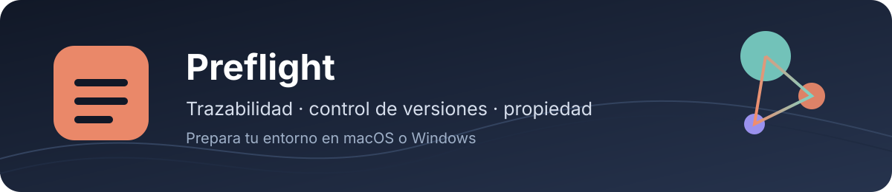

<p align="center">
  
</p>

<h1 align="center">Agentic AI Automation Preflight</h1>
<p align="center"><strong>Prepara tu entorno en macOS o Windows</strong></p>

<p align="center">
  
  
  
  
  
  
</p>

<p align="center"><em>Antes de agentizar, aprende a cuidar tu propio espacio de trabajo.</em></p>

Este repositorio no es la sesión técnica ni un agente completo. Es tu **primer checkpoint de trazabilidad, control de versiones y propiedad de tu espacio de trabajo**.

Al terminar, debes poder responder tres preguntas:

1. ¿Dónde está mi propio repositorio?
2. ¿Qué hice, cuándo lo hice y cómo puedo volver atrás?
3. ¿Qué herramientas tengo, cuál me falta y qué fallback usaré?

## Empieza aquí: una secuencia de 75–110 minutos

Sigue los pasos en orden. **No hagas el commit de cierre antes de completar la Terminal Lab.** La Terminal Lab crea un commit pequeño de práctica; al final harás un commit de cierre con tu reporte e intención.

### 0. Crea tu propio repositorio

No trabajes permanentemente dentro del repositorio de la clase. Primero crea tu cuenta de GitHub y luego usa este repositorio como plantilla:

1. En GitHub, pulsa **Use this template → Create a new repository**.
2. Crea un repo propio, por ejemplo `mi-proyecto-agentico`.
3. Elige una visibilidad compatible con la información que manejarás. Para datos reales o de clientes, usa un repositorio privado.
4. Clona **tu propio repo**, no el repo de la clase.

### 1. Clona y entra a tu repo

#### Opción A — Terminal con Git

```bash
git clone https://github.com/TU-USUARIO/TU-REPO.git
cd TU-REPO
```

En Windows PowerShell:

```powershell
git clone https://github.com/TU-USUARIO/TU-REPO.git
cd TU-REPO
```

#### Opción B — GitHub Desktop

Abre GitHub Desktop, inicia sesión y clona tu repo propio. Si `git --version` funciona en la terminal que abras, selecciona **Open in terminal** y continúa con esta página. Si no funciona, completa la ruta visual de [`docs/fallback.md`](docs/fallback.md) y registra que la ruta de terminal quedó pendiente; no intentes ejecutar comandos de Git que tu terminal no reconoce.

#### Descargar ZIP: solo como fallback

Descargar ZIP sirve para no quedarse bloqueado, pero **no conserva el historial ni enseña el flujo de clonación, commit y push**. Si usas ZIP, registra el bloqueo y crea después tu repo propio desde GitHub Desktop o desde la web.

### 2. Ejecuta el diagnóstico

Ejecuta el preflight desde la raíz de tu repo propio:

```bash
python3 preflight/preflight.py
```

En Windows:

```powershell
py preflight/preflight.py
```

El script no instala nada, no llama a una API y no necesita una API key. Escribe `evidence/preflight-report.md` sin guardar secretos.

Lee el resultado, pero **no hagas todavía el commit de cierre**: primero completa la Terminal Lab. Si aparece `PARTIAL`, conserva el mensaje y sigue con el fallback correspondiente.

### 3. Elige tu ritmo

#### Ruta normal — núcleo común, 35–45 minutos

Completa el [Terminal Lab](terminal-lab/README.md). Aprenderás a ubicarte, navegar, crear y leer archivos, hacer una edición reversible, revisar Git, guardar un commit pequeño y leer un error seguro.

#### Fast lane — 15–20 minutos, para quien ya trae evidencia

Puedes saltar el núcleo si ya puedes demostrar las cinco piezas siguientes:

- un repo propio de GitHub;
- un commit reciente que puedas localizar;
- `git status` y `git diff` explicados con tus palabras;
- una automatización, prototipo o proceso que quieras revisar;
- una falla, decisión o cuello de botella documentado.

En la fast lane, completa el preflight, escribe tu intención y pide a Claude Code o Cowork una inspección de solo lectura. La evidencia equivalente debe quedar en tu repo. Si no puedes demostrar alguna pieza, vuelve al núcleo.

La secuencia didáctica es:

> observar → explicar → proponer → revisar → ejecutar → verificar → versionar

### 4. Escribe intención y guarda el commit de cierre

Después de la Ruta normal o la fast lane:

1. Revisa `evidence/preflight-report.md`.
2. Completa `notes/intent.md` con el proceso, problema o automatización que quieres explorar.
3. Añade solo los archivos que entiendes.
4. Revisa el staging antes de confirmar.

```bash
git add evidence/preflight-report.md notes/intent.md notes/terminal-lab/prueba.txt
git diff --cached
git commit -m "chore: complete environment preflight"
git push
```

Si elegiste la fast lane y no tienes `notes/terminal-lab/prueba.txt`, añade únicamente los archivos que realmente creaste:

```bash
git add evidence/preflight-report.md notes/intent.md
git diff --cached
git commit -m "chore: complete environment preflight"
git push
```

En Windows PowerShell se usan los mismos comandos de Git. No uses `git add .` sin revisar qué estás incluyendo.

### 5. Entra a Claude Code o usa el fallback

Si Claude Code está instalado:

```bash
claude --version
claude doctor
claude
```

En Windows PowerShell se usan los mismos comandos. La primera sesión puede pedir autenticación en el navegador. Claude Code requiere una modalidad de acceso compatible; el plan gratuito de claude.ai no incluye Claude Code. No guardes credenciales ni API keys en el repo.

Dentro de Claude Code, empieza con una petición de solo lectura:

```text
Explica en lenguaje sencillo dónde estoy, qué archivos relevantes ves y cuál es el estado de Git. No modifiques ningún archivo ni ejecutes comandos destructivos.
```

Si Claude Code no está disponible, marca `PARTIAL`, conserva el reporte y usa Cowork solo si tienes acceso compatible. Si tampoco tienes Cowork, sigue el fallback manual documentado. El objetivo del preflight es llegar con evidencia, no convertir esta actividad en una sesión interminable de instalación.

## Ya terminaste cuando puedes mostrar

- la URL de tu repo propio;
- `evidence/preflight-report.md`;
- `notes/intent.md`;
- `notes/terminal-lab/prueba.txt`, si hiciste la Ruta normal;
- un commit visible en GitHub;
- qué herramienta usarás y qué fallback tienes;
- una decisión o siguiente paso que quieras llevar a la sesión técnica.

## Cómo leer el resultado

- **PASS:** lo necesario para este checkpoint está disponible.
- **PARTIAL:** puedes avanzar, pero falta una herramienta de la ruta principal o debes usar un fallback.
- **DEFERRED:** la comprobación depende de tu proyecto y todavía no corresponde instalarla.
- **BLOCKED:** primero resuelve el bloqueo o usa el fallback documentado.

## Qué revisa y qué no

El preflight comprueba Python, Git, que la raíz Git coincida con esta carpeta, la identidad local del primer commit, que estés trabajando dentro de un repositorio GitHub que no sea la plantilla, el dataset sintético y la disponibilidad de Claude Code.

La comprobación del repo es indirecta: verifica que la raíz Git coincida con esta carpeta y compara el remoto `origin` con la pareja exacta de la plantilla. No inicia sesión en GitHub ni puede demostrar por sí sola quién es la persona propietaria.

Claude Code es la ruta principal del curso. Si no está disponible, el resultado será `PARTIAL` y podrás continuar con Cowork como fallback mientras resuelves la instalación.

### Dependencias condicionales

Node.js y npm se detectan como información, pero **no se marcan como bloqueo**. El instalador nativo recomendado de Claude Code no necesita Node.js. La ruta npm sigue disponible si la eliges deliberadamente y requiere Node.js 22 o superior; no conviertas ninguna de esas rutas en instalación universal. La base de datos se decide después de definir qué quieres agentizar y qué arquitectura necesita.

GitHub CLI (`gh`) es útil, pero no es requisito. Git o GitHub Desktop sí forman parte del aprendizaje porque permiten conservar historial, revisar cambios y recuperar decisiones.

## Qué significa ser dueño(a) de tu espacio

Tu repo propio será el lugar donde guardarás decisiones, notas, evidencias, prompts y cambios revisables. La meta no es llenar carpetas: es que otra persona pueda entender qué intentaste, qué cambió y cómo volver a un estado anterior.

No subas API keys, contraseñas, transcripts con datos personales ni información de clientes. Revisa [`docs/seguridad-basica.md`](docs/seguridad-basica.md) antes de guardar evidencia.

## Si algo falla

Consulta [`docs/fallback.md`](docs/fallback.md). Si Claude Code falla, no conviertas la actividad en una instalación interminable: conserva el mensaje, usa Cowork o el fallback de papel y registra qué quedó pendiente.

Para aprender la diferencia entre descargar, clonar, hacer commit y hacer push, abre [`docs/git-y-github.md`](docs/git-y-github.md).

## Fuentes oficiales

- [Claude Code — instalación y requisitos](https://code.claude.com/docs/en/setup)
- [Claude Code — quickstart](https://code.claude.com/docs/en/quickstart)
- [Claude Code — guía de terminal](https://code.claude.com/docs/en/terminal-guide)

Este repo **no contiene S2, comandos internos del Mentor, rúbricas del facilitador ni la solución completa del camino dorado**.
